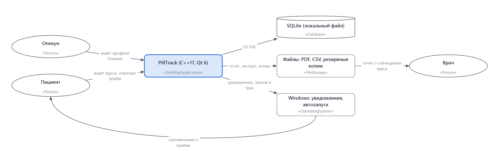
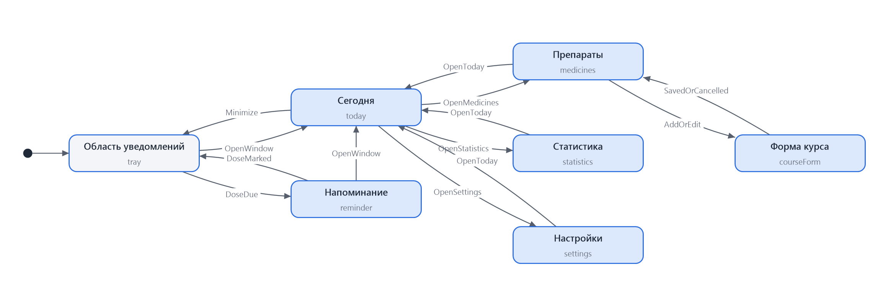
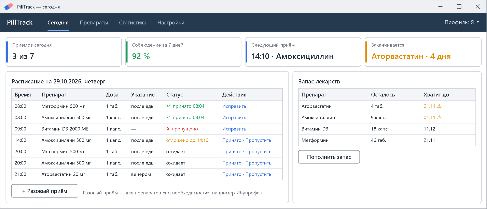
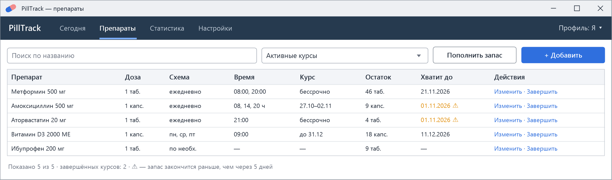
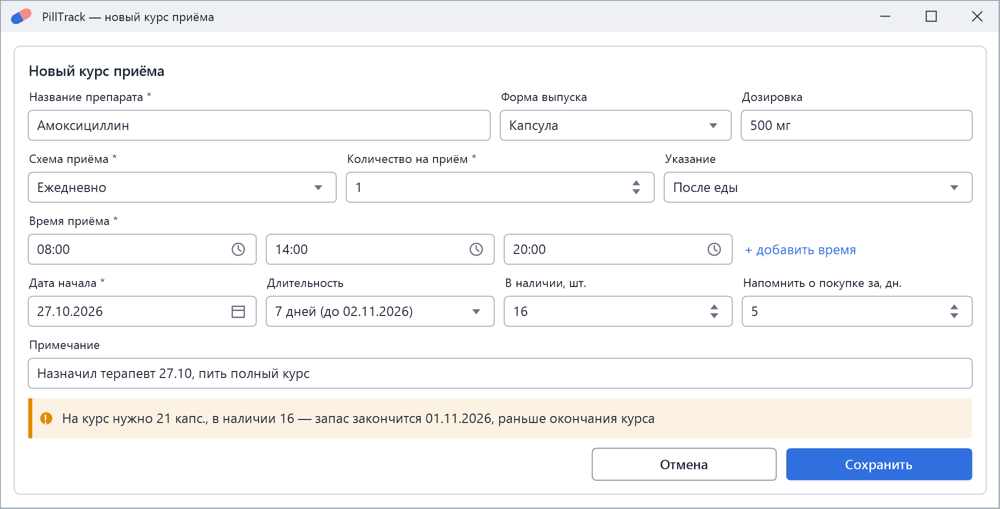
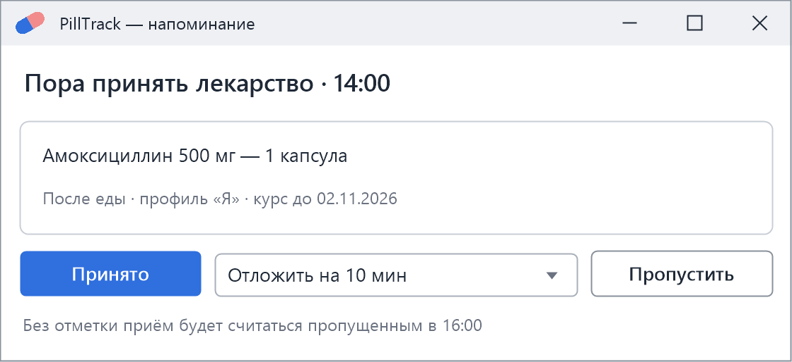
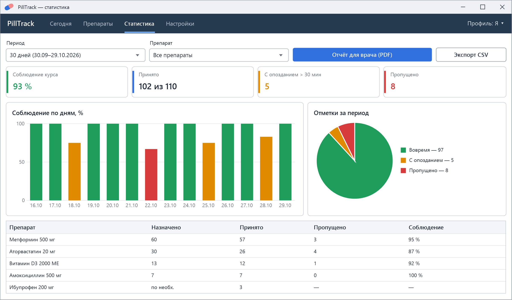
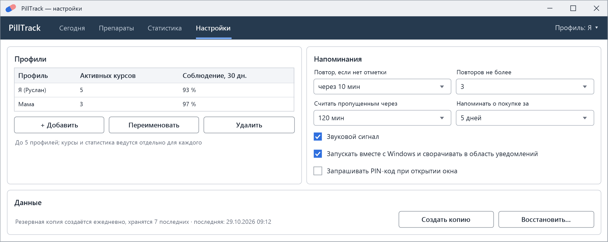

# Спецификация требований к ПО

Для PillTrack — настольного приложения учёта приёма лекарств

Версия 0.2

Подготовил Пилютик Р.А., гр. 434701

БГУИР, кафедра ЭВМ, дисциплина «Жизненный цикл разработки программного обеспечения»

29.10.2026

## Оглавление

<!-- TOC -->
* [1. Введение](#1-introduction)
  * [1.1 Назначение документа](#11-document-purpose)
  * [1.2 Область применения продукта](#12-product-scope)
  * [1.3 Определения, акронимы и сокращения](#13-definitions-acronyms-and-abbreviations)
  * [1.4 Ссылки](#14-references)
  * [1.5 Обзор документа](#15-document-overview)
* [2. Обзор продукта](#2-product-overview)
  * [2.1 Перспектива продукта](#21-product-perspective)
  * [2.2 Функции продукта](#22-product-functions)
  * [2.3 Ограничения продукта](#23-product-constraints)
  * [2.4 Характеристики пользователей](#24-user-characteristics)
  * [2.5 Допущения и зависимости](#25-assumptions-and-dependencies)
  * [2.6 Распределение требований](#26-apportioning-of-requirements)
* [3. Требования](#3-requirements)
  * [3.1 Внешние интерфейсы](#31-external-interfaces)
    * [3.1.1 Пользовательские интерфейсы](#311-user-interfaces)
    * [3.1.2 Аппаратные интерфейсы](#312-hardware-interfaces)
    * [3.1.3 Программные интерфейсы](#313-software-interfaces)
  * [3.2 Функциональные требования](#32-functional)
  * [3.3 Качество обслуживания](#33-quality-of-service)
    * [3.3.1 Производительность](#331-performance)
    * [3.3.2 Безопасность](#332-security)
    * [3.3.3 Надёжность](#333-reliability)
    * [3.3.4 Доступность](#334-availability)
    * [3.3.5 Наблюдаемость](#335-observability)
  * [3.4 Соответствие стандартам](#34-compliance)
  * [3.5 Проектирование и реализация](#35-design-and-implementation)
    * [3.5.1 Установка](#351-installation)
    * [3.5.2 Сборка и поставка](#352-build-and-delivery)
    * [3.5.3 Распределение](#353-distribution)
    * [3.5.4 Сопровождаемость](#354-maintainability)
    * [3.5.5 Повторное использование](#355-reusability)
    * [3.5.6 Переносимость](#356-portability)
    * [3.5.7 Стоимость](#357-cost)
    * [3.5.8 Сроки](#358-deadline)
    * [3.5.9 Доказательство концепции](#359-proof-of-concept)
    * [3.5.10 Управление изменениями](#3510-change-management)
  * [3.6 ИИ/МО](#36-aiml)
* [4. Верификация](#4-verification)
* [5. Приложения](#5-appendixes)
<!-- TOC -->

## История изменений

| Name | Date | Reason For Changes | Version |
|------|------|--------------------|---------|
| Пилютик Р.А. | 27.10.2026 | Первая версия по результатам первого интервью с Заказчиком; открытые вопросы вынесены в приложение Б | 0.1 |
| Пилютик Р.А. | 29.10.2026 | Решения Заказчика по открытым вопросам: добавлены REQ-FUNC-018 – REQ-FUNC-020 и CON-6, изменены REQ-INT-003, REQ-FUNC-002, REQ-FUNC-005, REQ-FUNC-006, REQ-FUNC-008, REQ-FUNC-013; обновлены бизнес-цели, глоссарий, инкременты, матрица верификации, мокапы | 0.2 |

---

## 1. Введение {#1-introduction}

Документ описывает требования к PillTrack — настольному приложению для Windows, которое помогает вести курсы приёма лекарств: хранит назначенные препараты и схемы приёма, напоминает о приёме, ведёт отметки «принято» / «пропущено», следит за остатком таблеток и показывает статистику соблюдения курса. Раздел 1 задаёт цели и границы продукта, раздел 2 — контекст и ограничения, раздел 3 — проверяемые требования, раздел 4 — способ их проверки.

### 1.1 Назначение документа {#11-document-purpose}

SRS фиксирует, **что** должна делать система PillTrack, и служит основой для проектирования (SDD, ADR), разработки и приёмки. Документ используют:

- Заказчик (напарник по учебной паре, затем преподаватель) — для согласования объёма и приёмки инкрементов;
- разработчик — для проектирования и реализации;
- тестировщик (тот же разработчик) — для составления тестов по критериям приёмки.

Документ не описывает архитектуру и внутреннее устройство программы — эти решения будут приняты в SDD и ADR.

### 1.2 Область применения продукта {#12-product-scope}

**PillTrack 1.0** — однопользовательское настольное приложение, работающее на одном компьютере без подключения к Интернету. Оно решает проблему пропусков и путаницы при приёме нескольких лекарств по разным схемам, в том числе когда человек следит ещё и за лекарствами близких.

Бизнес-цели:

| ID | Цель | Показатель успеха |
|----|------|-------------------|
| BG-1 | Не пропускать приём лекарств | Напоминание приходит в назначенное время; доля принятых доз у пользователя за первый месяц использования — не ниже 90 % |
| BG-2 | Не оставаться без лекарства | Система предупреждает о заканчивающемся запасе заранее (по умолчанию за 5 дней); за 3 месяца использования нет ни одного дня, когда препарат закончился без предупреждения |
| BG-3 | Показать врачу, как соблюдался курс | За 1 минуту пользователь получает отчёт о соблюдении курса за выбранный период |
| BG-4 | Вести лекарства всей семьи в одном месте | Один пользователь ведёт курсы до 5 человек (профили) без смешивания данных |
| BG-5 | Конфиденциальность и нулевая стоимость владения | Данные хранятся только на компьютере пользователя; используются только бесплатные компоненты |

**Входит в продукт:** учёт препаратов и курсов приёма, расписание на день, напоминания с откладыванием, отметки приёма, учёт и прогноз остатка, напоминание о покупке, статистика соблюдения, отчёт для врача (PDF) и экспорт (CSV), профили, резервное копирование.

**Не входит в продукт:** медицинские рекомендации, подбор дозировок, проверка совместимости препаратов, справочник лекарств с инструкциями, заказ лекарств в аптеке, синхронизация с телефоном и облаком, передача данных врачу через Интернет.

### 1.3 Определения, акронимы и сокращения {#13-definitions-acronyms-and-abbreviations}

| Term | Definition |
|------|------------|
| API | Application Programming Interface — набор определений и протоколов для создания и интеграции прикладного ПО |
| CSV | Comma-Separated Values — текстовый табличный формат с разделителями |
| PDF | Portable Document Format — формат электронных документов |
| SRS | Software Requirements Specification — документ, описывающий назначение, требования и характер ПО |
| UI | User Interface — визуальная часть приложения, через которую пользователь взаимодействует с ПО |
| Доза | Однократный приём препарата по расписанию: препарат, количество и плановое время |
| Запас (остаток) | Количество единиц препарата (таблеток, капсул), которое есть у пользователя |
| Курс приёма | Назначение препарата: схема, время приёма, количество на приём, дата начала и длительность |
| Отметка | Состояние дозы: «ожидает», «отложено», «принято», «пропущено» |
| Опекун | Пользователь, который ведёт курсы приёма другого человека в отдельном профиле |
| Приём по необходимости | Препарат без расписания, принимаемый при симптомах; учитывается в запасе и статистике разовых приёмов |
| Профиль | Набор курсов, отметок и статистики одного человека |
| Соблюдение курса | Доля принятых доз от назначенных за период, в процентах |
| Схема приёма | Правило повторения: ежедневно, по дням недели, каждые N дней или по необходимости |
| Трей | Область уведомлений панели задач Windows |

### 1.4 Ссылки {#14-references}

| Документ | Владелец, версия | Расположение | Статус |
|----------|------------------|--------------|--------|
| ISO/IEC/IEEE 29148:2018 Requirements engineering | ISO/IEC/IEEE | iso.org | справочный |
| Шаблон SRS | кафедра ЭВМ БГУИР | [srs-template.md](srs-template.md) | нормативный |
| Модели интерфейса на SysML v2 | Пилютик Р.А., 0.2 | [models/](models/) | нормативный |
| Закон Республики Беларусь № 99-З «О защите персональных данных» | Республика Беларусь, 07.05.2021 | pravo.by | нормативный |
| Qt 6 Documentation | The Qt Company | doc.qt.io | справочный |
| Microsoft Windows App Notifications | Microsoft | learn.microsoft.com | справочный |

### 1.5 Обзор документа {#15-document-overview}

Раздел 2 описывает контекст, функции, ограничения (CON), пользователей, допущения (ASM) и распределение требований по инкрементам. Раздел 3 содержит требования с идентификаторами `REQ-[AREA]-[NNN]-[VER]`: каждое имеет формулировку со словом «должна», обоснование, критерии приёмки и метод верификации. Раздел 4 — матрица верификации, раздел 5 — приложения (графические материалы, вопросы к Заказчику). Документ хранится в репозитории; изменения вносятся через pull request, каждая версия фиксируется в таблице «История изменений», изменённое требование получает следующий суффикс версии.

---

## 2. Обзор продукта {#2-product-overview}

### 2.1 Перспектива продукта {#21-product-perspective}

PillTrack — новый самостоятельный продукт, не входящий в более крупную систему. Приложение работает на компьютере пользователя под Windows, хранит данные в локальном файле базы данных SQLite, использует центр уведомлений Windows для напоминаний и файловую систему для отчётов, экспорта и резервных копий. Внешних сетевых сервисов нет. Владелец продукта — автор (учебный проект), поддержка — в течение семестра.

*Рисунок 1 — Контекстная диаграмма (модель [models/Context.sysml](models/Context.sysml))*

### 2.2 Функции продукта {#22-product-functions}

- **Препараты и курсы:** добавление препарата, схемы и времени приёма, длительности курса; изменение и завершение курса.
- **Расписание на день:** список доз на сегодня с отметками.
- **Напоминания:** уведомление Windows в назначенное время, откладывание, повтор, автоматическая отметка «пропущено».
- **Отметки приёма:** «принято», «пропущено», исправление ошибочной отметки, разовый приём по необходимости.
- **Запас:** списание при приёме, пополнение, прогноз даты окончания, напоминание о покупке.
- **Статистика и отчёты:** соблюдение курса по дням и препаратам, отчёт для врача (PDF), экспорт (CSV).
- **Профили:** раздельный учёт для нескольких человек.
- **Данные:** ежедневная резервная копия и восстановление.

### 2.3 Ограничения продукта {#23-product-constraints}

| ID | Ограничение | Тип |
|----|-------------|-----|
| CON-1 | Приложение должно быть разработано на C++17 с использованием Qt 6 (Widgets) и системы сборки CMake | внутреннее, обязательное |
| CON-2 | Приложение должно работать в Windows 10 и Windows 11 (x64) | внешнее, обязательное |
| CON-3 | Данные должны храниться локально в SQLite; приложение не должно требовать подключения к Интернету и сервера | внешнее, обязательное |
| CON-4 | Должны использоваться только бесплатные компоненты (Qt по LGPL v3, SQLite) | внешнее, обязательное |
| CON-5 | Интерфейс должен быть на русском языке | внешнее, обязательное |
| CON-6 | Приложение не должно давать медицинских рекомендаций, подбирать дозировку и проверять совместимость препаратов | внешнее, обязательное |
| CON-7 | Релиз 1.0 должен быть готов до конца семестра; инкременты показываются на занятиях | организационное |
| CON-8 | Приложение не должно передавать данные пользователя третьим лицам и собирать телеметрию | внешнее, обязательное |

### 2.4 Характеристики пользователей {#24-user-characteristics}

| Класс | Описание | Частота | Особенности |
|-------|----------|---------|-------------|
| Пациент | Человек 18–70 лет, принимает 2–8 препаратов, часть — постоянно (давление, сахар), часть — курсами (антибиотики, витамины). Уверенно пользуется компьютером на базовом уровне | ежедневно, 1–5 раз в день, по 10–30 с | Нужны крупные понятные кнопки и минимум действий для отметки |
| Опекун | Ведёт приём лекарств пожилого родственника или ребёнка, обычно в дополнение к своему профилю | ежедневно | Нужно сразу видеть, чей приём, и переключать профили |
| Врач | Не пользуется приложением; получает от пациента отчёт PDF на приёме | раз в 1–3 месяца | Отчёт должен читаться без приложения |

### 2.5 Допущения и зависимости {#25-assumptions-and-dependencies}

| ID | Допущение / зависимость | Влияние, если неверно |
|----|-------------------------|-----------------------|
| ASM-1 | Компьютер пользователя включён в течение дня, когда нужно принимать лекарства | Напоминания не приходят; потребуется канал на телефоне (отложенное требование) |
| ASM-2 | В Windows разрешены уведомления для приложения | Напоминание видно только в окне приложения; при запуске выводится подсказка, как включить уведомления |
| ASM-3 | Пользователь сам вводит данные из назначения врача и отвечает за их правильность | Ошибка ввода ведёт к неверному расписанию; смягчение — проверка полей формы |
| ASM-4 | Объём данных: до 5 профилей, до 20 активных курсов в профиле, история до 3 лет | При большем объёме нужно повторно проверить REQ-PERF-002 |
| ASM-5 | Системное время компьютера установлено верно | Напоминания приходят в неверное время |

### 2.6 Распределение требований {#26-apportioning-of-requirements}

| Инкремент | Срок | Требования |
|-----------|------|------------|
| И1 — учёт и отметки | ЛР 4–5 | REQ-INT-001, REQ-FUNC-001 – REQ-FUNC-004, REQ-FUNC-007 – REQ-FUNC-012, REQ-PERF-002, REQ-REL-001 |
| И2 — напоминания и профили | ЛР 6–7 | REQ-INT-002, REQ-FUNC-005, REQ-FUNC-006, REQ-FUNC-013, REQ-FUNC-017, REQ-FUNC-018, REQ-PERF-001, REQ-PERF-003, REQ-SEC-001, REQ-SEC-002 |
| И3 — статистика и данные | ЛР 8 | REQ-INT-003, REQ-FUNC-014 – REQ-FUNC-016, REQ-FUNC-019, REQ-FUNC-020, REQ-REL-002, остальные требования раздела 3.5 |

**Отложенные требования** (после релиза 1.0): напоминания на телефон (мобильное приложение или Telegram), синхронизация между компьютерами, справочник препаратов.

---

## 3. Требования {#3-requirements}

Требования сформулированы для релиза 1.0. Все ограничения раздела 2.3 действуют для каждого требования.

### 3.1 Внешние интерфейсы {#31-external-interfaces}

#### 3.1.1 Пользовательские интерфейсы {#311-user-interfaces}

Интерфейс состоит из главного окна с вкладками «Сегодня», «Препараты», «Статистика», «Настройки», формы курса приёма и окна напоминания. Переходы между окнами показаны на рисунке 2, мокапы — на рисунках 3–8 (модель [models/Mockups.sysml](models/Mockups.sysml)).

*Рисунок 2 — Карта окон*

| Рисунок | Мокап |
|---------|-------|
| 3 — Сегодня |  |
| 4 — Препараты |  |
| 5 — Форма курса приёма |  |
| 6 — Напоминание |  |
| 7 — Статистика |  |
| 8 — Настройки |  |

- **ID:** REQ-INT-001
- **Title:** Главное окно
- **Statement:** Система должна предоставлять главное окно с вкладками «Сегодня», «Препараты», «Статистика», «Настройки» и выбором текущего профиля, корректно отображаемое при разрешении экрана от 1366×768 и масштабе 100–150 %.
- **Rationale:** Все ежедневные действия (BG-1) выполняются из одного окна.
- **Acceptance Criteria:** 1) все вкладки доступны одним щелчком; 2) при 1366×768 и масштабе 150 % элементы не обрезаются и не перекрываются; 3) все надписи на русском языке; 4) пустой список показывает подсказку «Добавьте первый препарат».
- **Verification Method:** Demonstration
- **More Information:** Рисунки 3–8.

#### 3.1.2 Аппаратные интерфейсы {#312-hardware-interfaces}

Специальных аппаратных интерфейсов нет. Используются стандартные устройства ввода-вывода компьютера (клавиатура, мышь, монитор, звуковой выход для сигнала напоминания).

#### 3.1.3 Программные интерфейсы {#313-software-interfaces}

- **ID:** REQ-INT-002
- **Title:** Уведомления Windows и трей
- **Statement:** Система должна показывать напоминания через центр уведомлений Windows и окно напоминания, а при закрытии главного окна — продолжать работу со значком в трее.
- **Rationale:** Напоминание должно быть заметно, даже когда окно приложения закрыто (BG-1).
- **Acceptance Criteria:** 1) уведомление содержит профиль, препарат, количество и время; 2) щелчок по уведомлению открывает окно напоминания; 3) меню значка в трее содержит «Открыть», «Сегодня», «Выход»; 4) если уведомления в Windows запрещены, при запуске показывается подсказка, как их включить.
- **Verification Method:** Demonstration
- **More Information:** Рисунок 6; ASM-2.

- **ID:** REQ-INT-003-2
- **Title:** Файлы обмена
- **Statement:** Система должна формировать отчёт в формате PDF, экспорт в формате CSV (UTF-8 с BOM, разделитель «;») и резервные копии в виде файла базы данных SQLite.
- **Rationale:** Отчёт должен открываться у врача без приложения (BG-3), CSV — в Excel, копия — восстанавливаться без конвертации.
- **Acceptance Criteria:** 1) PDF открывается в Adobe Reader и браузере, кириллица отображается; 2) CSV открывается в Excel двойным щелчком без искажения кириллицы; 3) резервная копия открывается приложением при восстановлении.
- **Verification Method:** Test
- **More Information:** Изменено в 0.2: добавлен формат PDF (решение по вопросу Б.6).

### 3.2 Функциональные требования {#32-functional}

- **ID:** REQ-FUNC-001
- **Title:** Добавление препарата
- **Statement:** Система должна позволять добавить препарат с полями: название (обязательно, 1–100 символов), форма выпуска (таблетка, капсула, капли, порошок, другое), дозировка (текст до 30 символов), единица учёта запаса.
- **Rationale:** Препарат — основа курса и учёта запаса.
- **Acceptance Criteria:** 1) без названия форма не сохраняется, поле подсвечивается; 2) сохранённый препарат появляется на вкладке «Препараты»; 3) препараты с одинаковым названием в одном профиле допускаются только с разной дозировкой.
- **Verification Method:** Test
- **More Information:** Рисунки 4, 5.

- **ID:** REQ-FUNC-002-2
- **Title:** Курс приёма
- **Statement:** Система должна позволять задать курс приёма: схему (ежедневно; по дням недели; каждые N дней, N = 2…30; по необходимости), от 1 до 6 значений времени приёма в сутки, количество на приём, указание (до еды, во время еды, после еды, натощак, без указания), дату начала и длительность (число дней, дата окончания или бессрочно).
- **Rationale:** Назначения врача различаются по схеме; без точного расписания нельзя напоминать (BG-1).
- **Acceptance Criteria:** 1) для каждой схемы расписание на 30 дней вперёд строится верно (проверка на наборе тестовых курсов); 2) нельзя сохранить курс без времени приёма, кроме схемы «по необходимости»; 3) дата окончания не может быть раньше даты начала.
- **Verification Method:** Test
- **More Information:** Изменено в 0.2: добавлена схема «каждые N дней» (вопрос Б.4). Рисунок 5.

- **ID:** REQ-FUNC-003
- **Title:** Изменение и завершение курса
- **Statement:** Система должна позволять изменить курс и досрочно завершить его; изменение действует для доз начиная с текущего момента, прошедшие отметки сохраняются.
- **Rationale:** Врач может изменить назначение; история нужна для статистики (BG-3).
- **Acceptance Criteria:** 1) после изменения времени приёма отметки за прошлые дни не меняются; 2) завершённый курс скрыт из «Сегодня» и доступен с фильтром «Завершённые»; 3) завершение требует подтверждения.
- **Verification Method:** Test

- **ID:** REQ-FUNC-004
- **Title:** Расписание на день
- **Statement:** Система должна показывать на вкладке «Сегодня» все дозы текущего профиля на текущие сутки, упорядоченные по времени, с препаратом, количеством, указанием и отметкой.
- **Rationale:** Пользователь за 2–3 секунды видит, что принято, а что нет (BG-1).
- **Acceptance Criteria:** 1) список совпадает с расписанием, построенным по REQ-FUNC-002; 2) после полуночи список обновляется без перезапуска; 3) вверху показаны показатели «Приёмов сегодня», «Соблюдение за 7 дней», «Следующий приём», «Заканчивается».
- **Verification Method:** Test
- **More Information:** Рисунок 3.

- **ID:** REQ-FUNC-005-2
- **Title:** Напоминание о приёме
- **Statement:** Система должна в плановое время каждой дозы показывать напоминание с профилем, препаратом, количеством, указанием и кнопками «Принято», «Отложить», «Пропустить»; дозы одного профиля с одинаковым временем объединяются в одно напоминание.
- **Rationale:** Главная причина пропусков — забывчивость (BG-1).
- **Acceptance Criteria:** 1) напоминание появляется не позже чем через 30 с после планового времени (REQ-PERF-003); 2) при трёх дозах на 20:00 показывается одно напоминание со списком; 3) в напоминании указан профиль.
- **Verification Method:** Test
- **More Information:** Изменено в 0.2: в напоминание добавлен профиль (вопрос Б.1). Рисунок 6.

- **ID:** REQ-FUNC-006-2
- **Title:** Отложить напоминание
- **Statement:** Система должна позволять отложить напоминание на 10, 30 или 60 минут; если дозу не отметили, напоминание повторяется через интервал из настроек (по умолчанию 10 минут), но не более 3 раз.
- **Rationale:** Пользователь может быть занят в момент напоминания; бесконечные повторы раздражают.
- **Acceptance Criteria:** 1) после «Отложить на 10 мин» доза получает отметку «отложено до ЧЧ:ММ» и напоминание повторяется через 10 мин ± 30 с; 2) после трёх повторов без отметки новые напоминания по этой дозе не показываются.
- **Verification Method:** Test
- **More Information:** Изменено в 0.2: заданы интервалы и число повторов (вопрос Б.5).

- **ID:** REQ-FUNC-007
- **Title:** Отметка «принято»
- **Statement:** Система должна позволять отметить дозу как принятую из напоминания и со вкладки «Сегодня», сохраняя фактическое время отметки.
- **Rationale:** Отметки — источник статистики (BG-3).
- **Acceptance Criteria:** 1) отметка занимает не более одного щелчка; 2) в списке отображается «✓ принято ЧЧ:ММ»; 3) отметка уменьшает запас (REQ-FUNC-010).
- **Verification Method:** Test

- **ID:** REQ-FUNC-008-2
- **Title:** Отметка «пропущено»
- **Statement:** Система должна позволять отметить дозу как пропущенную вручную, а дозу без отметки через заданное время (по умолчанию 120 минут, настраивается 30–240 минут) после планового отмечать как пропущенную автоматически.
- **Rationale:** Без автоматической отметки статистика будет неполной (BG-3).
- **Acceptance Criteria:** 1) доза на 14:00 без отметки получает «✗ пропущено» в 16:00; 2) пропуск не уменьшает запас; 3) в окне напоминания указано время автоматической отметки.
- **Verification Method:** Test
- **More Information:** Изменено в 0.2: добавлена автоматическая отметка (вопрос Б.5).

- **ID:** REQ-FUNC-009
- **Title:** Исправление отметки
- **Statement:** Система должна позволять исправить отметку дозы в течение 24 часов после её планового времени.
- **Rationale:** Пользователь может ошибиться или отметить приём позже, чем принял.
- **Acceptance Criteria:** 1) «пропущено» можно заменить на «принято» с указанием фактического времени; 2) запас пересчитывается; 3) отметки старше 24 часов изменить нельзя, кнопка «Исправить» недоступна.
- **Verification Method:** Test

- **ID:** REQ-FUNC-010
- **Title:** Учёт запаса
- **Statement:** Система должна хранить запас каждого препарата в единицах учёта и уменьшать его на количество дозы при отметке «принято» и при разовом приёме.
- **Rationale:** Без учёта запаса невозможен прогноз окончания (BG-2).
- **Acceptance Criteria:** 1) после отметки «принято» дозы «1 таб.» запас уменьшается на 1; 2) отмена отметки возвращает запас; 3) запас не становится отрицательным — при нулевом запасе отметка возможна, показывается предупреждение «Запас закончился».
- **Verification Method:** Test

- **ID:** REQ-FUNC-011
- **Title:** Пополнение запаса
- **Statement:** Система должна позволять пополнить запас препарата на указанное количество (например, «+30 таб.» после покупки упаковки).
- **Rationale:** Пользователь покупает лекарство и должен быстро учесть покупку (BG-2).
- **Acceptance Criteria:** 1) после пополнения запас и прогноз (REQ-FUNC-012) обновляются; 2) пополнение доступно с вкладок «Сегодня» и «Препараты».
- **Verification Method:** Test

- **ID:** REQ-FUNC-012
- **Title:** Прогноз окончания запаса
- **Statement:** Система должна рассчитывать по расписанию активных курсов дату, до которой хватит текущего запаса, и показывать её на вкладках «Сегодня» и «Препараты»; если запас закончится раньше окончания курса, это должно отмечаться предупреждением.
- **Rationale:** Пользователь заранее видит, когда нужно купить лекарство (BG-2).
- **Acceptance Criteria:** 1) для курса 3 раза в день (08:00, 14:00, 20:00) с запасом 9 капсул 29.10 после утреннего приёма дата — 01.11; 2) для курса «по необходимости» прогноз не выводится; 3) при запасе меньше потребности курса показывается предупреждение (рисунок 5).
- **Verification Method:** Test

- **ID:** REQ-FUNC-013-2
- **Title:** Напоминание о покупке
- **Statement:** Система должна один раз в сутки (в 10:00 или при первом запуске после этого времени) напоминать о препаратах, запаса которых хватит меньше чем на N дней; N задаётся для препарата (1–14, по умолчанию 5).
- **Rationale:** Пользователь не остаётся без лекарства (BG-2).
- **Acceptance Criteria:** 1) при прогнозе на 4 дня и N = 5 в 10:00 появляется уведомление «Заканчивается: …»; 2) повторное уведомление по тому же препарату — не чаще раза в сутки; 3) после пополнения напоминание прекращается.
- **Verification Method:** Test
- **More Information:** Изменено в 0.2: порог задаётся для каждого препарата (вопрос Б.3).

- **ID:** REQ-FUNC-014
- **Title:** Статистика соблюдения курса
- **Statement:** Система должна показывать за выбранный период (7, 30, 90 дней или произвольный) соблюдение курса в процентах, число назначенных, принятых, пропущенных доз и доз, принятых с опозданием более 30 минут, — в целом, по дням и по каждому препарату.
- **Rationale:** Пользователь и врач видят, как соблюдается лечение (BG-1, BG-3).
- **Acceptance Criteria:** 1) соблюдение = принятые / назначенные × 100 %, округление до целого; 2) значения совпадают с ручным подсчётом на тестовом наборе из 110 доз; 3) приёмы по необходимости показаны отдельно и не влияют на процент.
- **Verification Method:** Test
- **More Information:** Рисунок 7.

- **ID:** REQ-FUNC-015
- **Title:** Экспорт CSV
- **Statement:** Система должна выгружать отметки выбранного профиля за период в CSV со столбцами: дата, плановое время, фактическое время, препарат, количество, отметка.
- **Rationale:** Пользователь может обработать данные в Excel или передать их врачу.
- **Acceptance Criteria:** 1) число строк равно числу доз за период; 2) файл соответствует REQ-INT-003.
- **Verification Method:** Test

- **ID:** REQ-FUNC-016
- **Title:** Резервное копирование и восстановление
- **Statement:** Система должна ежедневно автоматически создавать резервную копию данных, хранить 7 последних копий, позволять создать копию вручную и восстановить данные из выбранной копии.
- **Rationale:** Потеря истории приёма недопустима для BG-3.
- **Acceptance Criteria:** 1) после 8 дней работы в папке копий 7 файлов; 2) после восстановления данные совпадают с данными на момент копии; 3) перед восстановлением запрашивается подтверждение.
- **Verification Method:** Test
- **More Information:** Рисунок 8.

- **ID:** REQ-FUNC-017
- **Title:** Работа в фоне и автозапуск
- **Statement:** Система должна по настройке запускаться вместе с Windows в свёрнутом виде и при закрытии главного окна продолжать работу в трее; полный выход — через меню значка в трее.
- **Rationale:** Напоминания работают, только пока приложение запущено (BG-1).
- **Acceptance Criteria:** 1) после перезагрузки Windows значок появляется в трее без участия пользователя; 2) закрытие окна крестиком не прекращает напоминания.
- **Verification Method:** Demonstration

- **ID:** REQ-FUNC-018
- **Title:** Профили
- **Statement:** Система должна позволять создать до 5 профилей, переименовать, удалить профиль (с подтверждением) и переключать текущий профиль; курсы, отметки, запас и статистика ведутся отдельно для каждого профиля, а напоминания приходят по всем профилям.
- **Rationale:** Опекун ведёт лекарства близких в том же приложении (BG-4).
- **Acceptance Criteria:** 1) препарат профиля «Мама» не виден в профиле «Я»; 2) напоминание по профилю «Мама» приходит, даже если открыт профиль «Я», и содержит имя профиля; 3) шестой профиль создать нельзя.
- **Verification Method:** Test
- **More Information:** Добавлено в 0.2 (вопрос Б.1). Рисунок 8.

- **ID:** REQ-FUNC-019
- **Title:** Приём по необходимости
- **Statement:** Система должна позволять отметить разовый приём препарата со схемой «по необходимости» с указанием количества и времени.
- **Rationale:** Обезболивающие и подобные препараты принимаются без расписания, но их запас и частоту нужно учитывать.
- **Acceptance Criteria:** 1) разовый приём уменьшает запас; 2) приём отображается в списке «Сегодня» и в статистике отдельно от назначенных доз.
- **Verification Method:** Test
- **More Information:** Добавлено в 0.2 (вопрос Б.4). Рисунок 3.

- **ID:** REQ-FUNC-020
- **Title:** Отчёт для врача
- **Statement:** Система должна формировать PDF-отчёт по профилю за выбранный период: список курсов с дозировками, соблюдение по препаратам, график соблюдения по дням и перечень пропущенных доз.
- **Rationale:** Врач на приёме за минуту видит, как соблюдалось назначение (BG-3).
- **Acceptance Criteria:** 1) отчёт формируется не дольше 5 с за период 90 дней; 2) данные отчёта совпадают со вкладкой «Статистика»; 3) отчёт помещается на 1–2 страницах A4 при 5 препаратах за 30 дней.
- **Verification Method:** Test
- **More Information:** Добавлено в 0.2 (вопрос Б.6). Рисунок 7.

### 3.3 Качество обслуживания {#33-quality-of-service}

#### 3.3.1 Производительность {#331-performance}

- **ID:** REQ-PERF-001
- **Title:** Время запуска
- **Statement:** Система должна открывать главное окно не дольше 3 с после запуска на компьютере с процессором не ниже Intel Core i3 8-го поколения, 8 ГБ ОЗУ и SSD.
- **Rationale:** Отметка приёма не должна ждать загрузки.
- **Acceptance Criteria:** Медиана 10 запусков на объёме данных ASM-4 — не более 3 с.
- **Verification Method:** Test

- **ID:** REQ-PERF-002
- **Title:** Отклик интерфейса
- **Statement:** Система должна выполнять переключение вкладок, профилей и сохранение отметок не дольше 0,5 с при объёме данных ASM-4.
- **Rationale:** Быстрый отклик снижает вероятность ошибочных повторных щелчков.
- **Acceptance Criteria:** 95-й процентиль времени операций на тестовой базе (5 профилей × 20 курсов × 3 года) — не более 0,5 с.
- **Verification Method:** Test

- **ID:** REQ-PERF-003
- **Title:** Точность напоминаний
- **Statement:** Система должна показывать напоминание не позже чем через 30 с после планового времени и не раньше него.
- **Rationale:** Ряд препаратов принимают строго по времени.
- **Acceptance Criteria:** В 20 проверках отклонение — от 0 до 30 с.
- **Verification Method:** Test

#### 3.3.2 Безопасность {#332-security}

- **ID:** REQ-SEC-001
- **Title:** Хранение данных
- **Statement:** Система должна хранить базу данных и резервные копии в папке профиля пользователя Windows (%LOCALAPPDATA%\PillTrack), доступной только этому пользователю.
- **Rationale:** Сведения о лекарствах — данные о здоровье, особая категория персональных данных (REQ-COMP-001).
- **Acceptance Criteria:** 1) другой пользователь Windows без прав администратора не может открыть файл базы; 2) приложение не создаёт файлов с данными вне этой папки, кроме явно выгруженных пользователем.
- **Verification Method:** Inspection

- **ID:** REQ-SEC-002
- **Title:** PIN-код
- **Statement:** Система должна по настройке запрашивать PIN-код из 4–8 цифр при открытии главного окна; PIN хранится только в виде хеша с солью; после 5 неверных попыток ввод блокируется на 5 минут.
- **Rationale:** Компьютер может быть общим для семьи.
- **Acceptance Criteria:** 1) в базе нет PIN-кода в открытом виде; 2) напоминания показываются без PIN, но не раскрывают другие курсы.
- **Verification Method:** Test

#### 3.3.3 Надёжность {#333-reliability}

- **ID:** REQ-REL-001
- **Title:** Целостность данных
- **Statement:** Система должна сохранять каждую отметку и изменение в отдельной транзакции, чтобы при аварийном завершении или отключении питания терялось не более последней незавершённой операции.
- **Rationale:** История приёма используется врачом (BG-3).
- **Acceptance Criteria:** При принудительном завершении процесса во время 100 последовательных отметок база открывается без ошибок, сохранены все отметки, кроме, возможно, последней.
- **Verification Method:** Test

- **ID:** REQ-REL-002
- **Title:** Восстановление после повреждения
- **Statement:** Система должна при запуске проверять целостность базы и при повреждении предлагать восстановление из последней исправной резервной копии.
- **Rationale:** Пользователь не должен остаться без данных.
- **Acceptance Criteria:** При запуске с испорченным файлом базы выводится сообщение и список копий; после выбора копии приложение работает.
- **Verification Method:** Test

#### 3.3.4 Доступность {#334-availability}

- **ID:** REQ-AVAIL-001
- **Title:** Автономная работа
- **Statement:** Система должна выполнять все функции без подключения к сети.
- **Rationale:** CON-3; напоминания не должны зависеть от Интернета.
- **Acceptance Criteria:** При отключённом сетевом адаптере все сценарии раздела 4 проходят.
- **Verification Method:** Demonstration

#### 3.3.5 Наблюдаемость {#335-observability}

- **ID:** REQ-OBS-001
- **Title:** Журнал ошибок
- **Statement:** Система должна записывать ошибки и предупреждения в файл журнала в папке приложения с ротацией (5 файлов по 1 МБ) без названий препаратов, имён профилей и другой личной информации.
- **Rationale:** Нужна диагностика ошибок без раскрытия данных о здоровье.
- **Acceptance Criteria:** 1) после ошибки открытия базы в журнале есть запись с временем и кодом ошибки; 2) поиск по журналу названий тестовых препаратов не даёт результатов.
- **Verification Method:** Inspection

### 3.4 Соответствие стандартам {#34-compliance}

- **ID:** REQ-COMP-001
- **Title:** Персональные данные
- **Statement:** Система должна обрабатывать сведения о здоровье только на устройстве пользователя, не передавать их третьим лицам и позволять удалить все данные профиля.
- **Rationale:** Закон Республики Беларусь № 99-З; CON-8.
- **Acceptance Criteria:** 1) анализ сетевой активности при работе показывает отсутствие исходящих соединений; 2) после удаления профиля его данные отсутствуют в базе.
- **Verification Method:** Analysis

- **ID:** REQ-COMP-002
- **Title:** Лицензии компонентов
- **Statement:** Система должна использовать Qt по лицензии LGPL v3 с динамической компоновкой и включать в поставку тексты лицензий используемых компонентов.
- **Rationale:** CON-4.
- **Acceptance Criteria:** В папке установки есть файлы лицензий Qt и SQLite, библиотеки Qt — отдельные DLL.
- **Verification Method:** Inspection

### 3.5 Проектирование и реализация {#35-design-and-implementation}

#### 3.5.1 Установка {#351-installation}

- **ID:** REQ-INST-001
- **Title:** Установка без прав администратора
- **Statement:** Система должна устанавливаться установщиком в папку пользователя без прав администратора и удаляться штатно с вопросом, удалять ли данные.
- **Rationale:** Пользователь часто работает без прав администратора.
- **Acceptance Criteria:** Установка и удаление под обычной учётной записью Windows проходят без запроса UAC.
- **Verification Method:** Demonstration

#### 3.5.2 Сборка и поставка {#352-build-and-delivery}

- **ID:** REQ-BUILD-001
- **Title:** Воспроизводимая сборка
- **Statement:** Система должна собираться из репозитория одной командой CMake (MSVC 2022, Qt 6.5 LTS и новее) с запуском модульных тестов.
- **Rationale:** Любой участник может собрать и проверить проект.
- **Acceptance Criteria:** На чистой машине с установленными Qt и Visual Studio по инструкции README сборка и тесты проходят.
- **Verification Method:** Demonstration

#### 3.5.3 Распределение {#353-distribution}

Не применимо: приложение работает на одном компьютере, распределённых компонентов нет.

#### 3.5.4 Сопровождаемость {#354-maintainability}

- **ID:** REQ-MAINT-001
- **Title:** Разделение на слои и тесты
- **Statement:** Система должна разделять представление (Qt Widgets), логику расписания и учёта и хранение данных; логика расписания, запаса и статистики должна быть покрыта модульными тестами не менее чем на 70 % строк.
- **Rationale:** Логика расписания — самая сложная и важная часть; изменения требований не должны ломать её незаметно.
- **Acceptance Criteria:** 1) модуль логики не зависит от Qt Widgets; 2) отчёт о покрытии показывает не менее 70 %.
- **Verification Method:** Analysis

#### 3.5.5 Повторное использование {#355-reusability}

Модуль построения расписания и прогноза запаса проектируется как отдельная библиотека без зависимостей от интерфейса, чтобы использовать его в будущем мобильном клиенте (отложенное требование).

#### 3.5.6 Переносимость {#356-portability}

- **ID:** REQ-PORT-001
- **Title:** Изоляция платформенного кода
- **Statement:** Система должна обращаться к API Windows (уведомления, автозапуск) только через отдельный модуль платформы.
- **Rationale:** Упрощает будущий перенос на Linux.
- **Acceptance Criteria:** Поиск по коду вне модуля платформы не находит включений `windows.h`.
- **Verification Method:** Inspection

#### 3.5.7 Стоимость {#357-cost}

- **ID:** REQ-COST-001
- **Title:** Нулевая стоимость
- **Statement:** Система должна разрабатываться и распространяться без платных лицензий и сервисов.
- **Rationale:** Бюджет проекта нулевой (BG-5).
- **Acceptance Criteria:** Перечень компонентов содержит только бесплатные лицензии.
- **Verification Method:** Inspection

#### 3.5.8 Сроки {#358-deadline}

- **ID:** REQ-DEAD-001
- **Title:** Инкременты
- **Statement:** Разработка должна вестись тремя инкрементами (раздел 2.6) с показом каждого на занятии; релиз 1.0 — до конца семестра.
- **Rationale:** CON-7.
- **Acceptance Criteria:** Каждый инкремент оформлен тегом в репозитории и показан преподавателю.
- **Verification Method:** Inspection

#### 3.5.9 Доказательство концепции {#359-proof-of-concept}

До начала И2 выполняется проверка концепции: уведомление Windows из приложения Qt 6 с кнопками действий, работающее при свёрнутом в трей окне. Критерий успеха — щелчок по кнопке «Принято» в уведомлении сохраняет отметку. Срок — 1 неделя; при неудаче используется собственное окно напоминания поверх остальных окон.

#### 3.5.10 Управление изменениями {#3510-change-management}

Изменения требований вносятся через pull request в ветку main после согласования с Заказчиком. Изменённое требование получает следующий суффикс версии (`-2`, `-3`), удалённое помечается «Отменено» и не удаляется из документа. Каждое изменение фиксируется в таблице «История изменений».

### 3.6 ИИ/МО {#36-aiml}

Не применимо: продукт не содержит компонентов машинного обучения.

---

## 4. Верификация {#4-verification}

Тесты выполняются на Windows 11 x64 с тестовой базой (5 профилей × 20 курсов × 3 года истории). Для проверки напоминаний используется подмена системного времени в модульных тестах и ручная демонстрация с реальным временем.

| Requirement ID | Verification Method | Test/Artifact Link | Status | Evidence |
|----------------|---------------------|--------------------|--------|----------|
| REQ-INT-001 | Demonstration | tests/ui/UI-01.md | Planned | |
| REQ-INT-002 | Demonstration | tests/ui/UI-02.md | Planned | |
| REQ-INT-003-2 | Test | tests/export/EXP-01.md | Planned | |
| REQ-FUNC-001 | Test | tests/medicine/MED-01.md | Planned | |
| REQ-FUNC-002-2 | Test | tests/schedule/SCH-01.md | Planned | |
| REQ-FUNC-003 | Test | tests/schedule/SCH-02.md | Planned | |
| REQ-FUNC-004 | Test | tests/schedule/SCH-03.md | Planned | |
| REQ-FUNC-005-2 | Test | tests/reminder/REM-01.md | Planned | |
| REQ-FUNC-006-2 | Test | tests/reminder/REM-02.md | Planned | |
| REQ-FUNC-007 | Test | tests/marks/MRK-01.md | Planned | |
| REQ-FUNC-008-2 | Test | tests/marks/MRK-02.md | Planned | |
| REQ-FUNC-009 | Test | tests/marks/MRK-03.md | Planned | |
| REQ-FUNC-010 | Test | tests/stock/STK-01.md | Planned | |
| REQ-FUNC-011 | Test | tests/stock/STK-02.md | Planned | |
| REQ-FUNC-012 | Test | tests/stock/STK-03.md | Planned | |
| REQ-FUNC-013-2 | Test | tests/stock/STK-04.md | Planned | |
| REQ-FUNC-014 | Test | tests/stats/STA-01.md | Planned | |
| REQ-FUNC-015 | Test | tests/export/EXP-02.md | Planned | |
| REQ-FUNC-016 | Test | tests/data/DAT-01.md | Planned | |
| REQ-FUNC-017 | Demonstration | tests/ui/UI-03.md | Planned | |
| REQ-FUNC-018 | Test | tests/profiles/PRF-01.md | Planned | |
| REQ-FUNC-019 | Test | tests/marks/MRK-04.md | Planned | |
| REQ-FUNC-020 | Test | tests/export/EXP-03.md | Planned | |
| REQ-PERF-001 | Test | tests/perf/PRF-START.md | Planned | |
| REQ-PERF-002 | Test | tests/perf/PRF-UI.md | Planned | |
| REQ-PERF-003 | Test | tests/reminder/REM-03.md | Planned | |
| REQ-SEC-001 | Inspection | docs/security-review.md | Planned | |
| REQ-SEC-002 | Test | tests/security/SEC-01.md | Planned | |
| REQ-REL-001 | Test | tests/data/DAT-02.md | Planned | |
| REQ-REL-002 | Test | tests/data/DAT-03.md | Planned | |
| REQ-AVAIL-001 | Demonstration | tests/ui/UI-04.md | Planned | |
| REQ-OBS-001 | Inspection | docs/logging-review.md | Planned | |
| REQ-COMP-001 | Analysis | docs/privacy-analysis.md | Planned | |
| REQ-COMP-002 | Inspection | docs/licenses.md | Planned | |
| REQ-INST-001 | Demonstration | tests/install/INS-01.md | Planned | |
| REQ-BUILD-001 | Demonstration | README.md | Planned | |
| REQ-MAINT-001 | Analysis | reports/coverage | Planned | |
| REQ-PORT-001 | Inspection | docs/code-review.md | Planned | |
| REQ-COST-001 | Inspection | docs/licenses.md | Planned | |
| REQ-DEAD-001 | Inspection | git tags | Planned | |

---

## 5. Приложения {#5-appendixes}

### Приложение А. Графические материалы

Графическая часть описана на SysML v2 в текстовой нотации; изображения строятся командой
`dotnet run --project srs/tools/Sysml2Png -- srs/models srs/images`.

| Файл модели | Содержание | Изображения |
|-------------|------------|-------------|
| [models/UiKit.sysml](models/UiKit.sysml) | Библиотека элементов интерфейса | — |
| [models/Mockups.sysml](models/Mockups.sysml) | Шесть окон приложения | [mockup-today.png](images/mockup-today.png), [mockup-medicines.png](images/mockup-medicines.png), [mockup-course-form.png](images/mockup-course-form.png), [mockup-reminder.png](images/mockup-reminder.png), [mockup-statistics.png](images/mockup-statistics.png), [mockup-settings.png](images/mockup-settings.png) |
| [models/Context.sysml](models/Context.sysml) | Контекст системы и карта окон | [context.png](images/context.png), [screen-flow.png](images/screen-flow.png) |

### Приложение Б. Вопросы к Заказчику и принятые решения

| № | Вопрос (версия 0.1) | Решение Заказчика (версия 0.2) | Затронутые требования |
|---|---------------------|-------------------------------|------------------------|
| Б.1 | Нужно ли вести лекарства нескольких людей? | Да: до 5 профилей; напоминания приходят по всем профилям и содержат имя профиля | REQ-FUNC-018, REQ-FUNC-005-2 |
| Б.2 | Нужна ли синхронизация с телефоном или облаком? | Нет в релизе 1.0: данные только на компьютере; напоминания на телефон — отложенное требование | CON-3, раздел 2.6 |
| Б.3 | Как заранее напоминать о покупке? | Порог в днях задаётся для каждого препарата, 1–14, по умолчанию 5 | REQ-FUNC-013-2 |
| Б.4 | Какие схемы приёма нужны? | Ежедневно, по дням недели, каждые N дней и «по необходимости» с разовой отметкой | REQ-FUNC-002-2, REQ-FUNC-019 |
| Б.5 | Что делать, если пользователь не отметил приём? | Повтор через 10 мин, не более 3 раз; через 120 мин — «пропущено» автоматически; исправление в течение 24 ч | REQ-FUNC-006-2, REQ-FUNC-008-2, REQ-FUNC-009 |
| Б.6 | В каком виде показывать данные врачу? | Отчёт PDF за период, дополнительно CSV | REQ-FUNC-020, REQ-INT-003-2 |
| Б.7 | Нужен ли справочник лекарств и проверка совместимости? | Нет: это медицинские рекомендации, за которые приложение не может отвечать | CON-6 |
